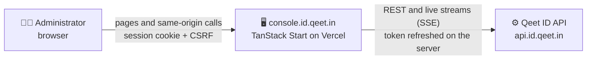

<div align="center">

# 🖥️ Qeet ID console

**Where an organisation runs Qeet ID: its people and groups, the applications that sign in with it, how people
sign in, who may do what, security and audit, and the keys and agents its software uses. At
[console.id.qeet.in](https://console.id.qeet.in).**

[](https://tanstack.com/start)
[](https://react.dev)
[](https://ui.qeet.in)
[](https://www.typescriptlang.org)
[](https://bun.sh)
[](https://console.id.qeet.in)

[🏗️ Architecture](#️-architecture) · [🧭 What's inside](#-whats-inside) · [🚀 Run it](#-run-it-locally) · [⚙️ Configuration](#️-configuration)

</div>

## 🏗️ Architecture

A TanStack Start app on Vercel that is its own backend-for-frontend. The browser talks only to the console;
the console's server calls the Qeet ID API. The API's tokens live in an encrypted HttpOnly session cookie and
never reach browser code.



| Part | Where |
|:--|:--|
| 🧩 **Modules** | One folder per area (18). Each has its routes, API calls, components and text, and a manifest that adds its pages to the navigation, search and Qeet AI: `src/modules` |
| 🧱 **Platform** | The one HTTP client, the session, errors, query, feature flags, telemetry and config: `src/platform` |
| 🛡️ **Security** | CSRF checks on every change, a per-request nonce Content-Security-Policy, step-up before sensitive actions, and each page and action shown only to people with its permission: `src/platform/security` |
| 🔌 **API contract** | The server's API documents, copied into `contract/`; every call is typed against them |
| 🎨 **Design** | Qeetrix (`@qeetrix/react` on its `AppShell`, `--qx-*` tokens, `@qeetrix/icons`), light and dark, WCAG 2.2 AA |
| 🌍 **Text** | i18next catalogues: `src/i18n` and each module's `locales/` |
| 🩺 **Health** | `GET /healthz` |

Imports only point down the layers, `app → modules → platform → shared`, and a module reaches another only
through its public `index.ts`. Biome and a test enforce both. Working on the console? Start with
[`AGENTS.md`](AGENTS.md) and [`docs/llm/context.md`](docs/llm/context.md).

## 🧭 What's inside

| Area | What an administrator does there |
|:--|:--|
| 📊 **Overview** | The Dashboard: sign-ins, two-step coverage, what needs attention, security, live activity and the organisation's shape |
| 👥 **Directory** | People (search, filters, bulk actions, invitations, suspended and deleted), groups as a tree, organisations, and directory sync over SCIM and LDAP / AD |
| 🧩 **Applications** | OpenID Connect and OAuth applications, and the access people granted them |
| 🔑 **Authentication** | Passkeys, password, passwordless and magic links, social sign-in, SAML single sign-on, two-step (TOTP, SMS, email) and device sign-ins |
| 🛂 **Authorization** | Roles and permissions (RBAC), attribute rules (ABAC), relationships (ReBAC), templates, versions and a tester |
| 🛡️ **Security** | The audit log and log streams, anomalies, bots, risk, IP rules and rate limits; SOC 2, ISO 27001, GDPR and data retention |
| 🛠️ **Developer** | API keys, machine identities and AI agents, tokens, signing keys, secrets, webhooks, auth hooks and verifiable credentials |
| ⚙️ **Settings** | The organisation's profile, domains, branding, emails, security policy, billing and Qeet AI |
| 🤖 **Qeet AI** | An assistant in a side drawer that reads and explains the organisation's setup; it makes no changes |

**⌘K** finds any page or action, and **?** lists the keyboard shortcuts.

## 🚀 Run it locally

Needs [Bun](https://bun.sh) 1.3+ and a running [`qeet-id-server`](https://github.com/qeetgroup/qeet-id-server)
(local default `http://localhost:4001`).

```bash
bun install --frozen-lockfile
cp .env.example .env.local
bun run dev            # http://localhost:3002
```

| Script | For |
|:--|:--|
| `bun run dev` | Development server on port 3002 |
| `bun run build` | Production build (Vite and Nitro) |
| `bun run typecheck` | Types |
| `bun run check` | Lint and format (Biome), including the layer rules |
| `bun run test` | Unit and component tests (Vitest) |
| `bun run test:e2e` | The production build in Chromium against a fake API: sign-in and session, organisation isolation, Content-Security-Policy, keyboard use and a WCAG 2.2 AA scan, four workers at once |
| `bun run contract:sync` | Copy the server's API documents and regenerate the types every call is checked against |
| `bun run contract:check` | The copied documents and generated types are current |
| `bun run audit` | Known high or critical advisories in the dependencies |
| `bun run new-module <id>` | Add an area from the module template |
| `bun run sonar` | SonarQube analysis with coverage (local SonarQube from `qeet-id-server`) |

`VITE_ENABLE_DEVTOOLS=true bun run dev` shows the TanStack devtools.

## ⚙️ Configuration

| Variable | What it is |
|:--|:--|
| `VITE_API_URL` | The Qeet ID API, for example `http://localhost:4001` (public; built into the pages) |
| `SERVER_URL` | The API as the console's server reaches it; defaults to `VITE_API_URL` |
| `PUBLIC_API_URL` | Optional. The API address handed to the browser, read on each request, so one image serves any environment |
| `SESSION_SECRET` | Encrypts and signs the session cookie: 32 or more random characters, server only, required in production |
| `QEET_ID_RELAY_KEY` | Optional. One of the API's relay keys, so the API sees each person's own address; server only |
| `CONSOLE_TRUSTED_PROXY_HOPS` | Optional. How many proxies in front of the console add to `X-Forwarded-For` |
| `VITE_APP_TITLE` | The window title, `Qeet ID Admin` |

In production the server checks these as it starts and refuses to run until they are valid; its log names the
variable at fault, never its value.

## 🚢 Releasing

Releases are monthly and named after the month they ship.

1. Changes land on `develop`. Run the tests, the build and the browser tests locally before pushing; **Verify** in CI
   checks the API contract, types, formatting, lint, the dependency audit and that no secret was committed.
2. Each month `release/2027.1.0` (for example) is cut from `develop`, and testers check it in TEST and STAGING. A fix
   they need is made on `develop` first, then copied to the release branch.
3. After sign-off, the pull request from the release branch into `main` deploys
   [console.id.qeet.in](https://console.id.qeet.in) and tags `v2027.1.0`. An urgent fix afterwards is
   `hotfix/2027.1.1`.

## 🧩 Related repositories

| Repository | What it is |
|:--|:--|
| [`qeet-id-server`](https://github.com/qeetgroup/qeet-id-server) | The Qeet ID platform and its API |
| [`qeet-id-hosted`](https://github.com/qeetgroup/qeet-id-hosted) | Hosted sign-in, sign-up, consent and recovery pages, at [accounts.id.qeet.in](https://accounts.id.qeet.in) |
| [`qeet-id-website`](https://github.com/qeetgroup/qeet-id-website) | The public website, [id.qeet.in](https://id.qeet.in) |
| [`qeet-id-docs`](https://github.com/qeetgroup/qeet-id-docs) | The developer documentation |
| [`qeet-id-kit`](https://github.com/qeetgroup/qeet-id-kit) | Runs the whole product locally for testers |
